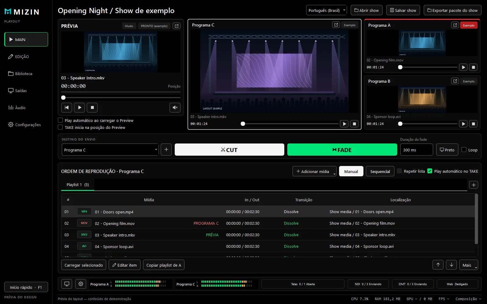
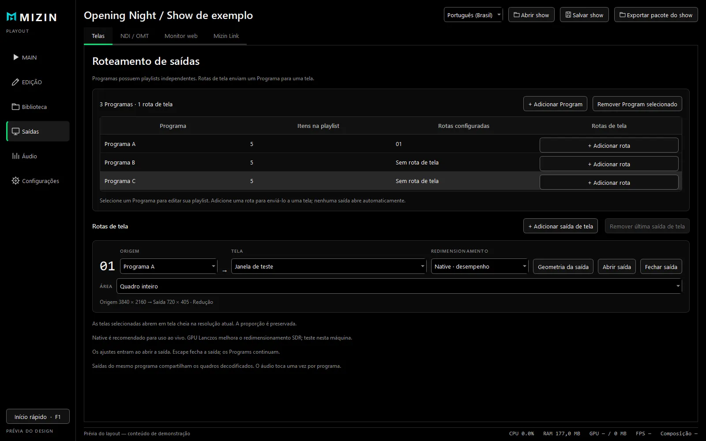
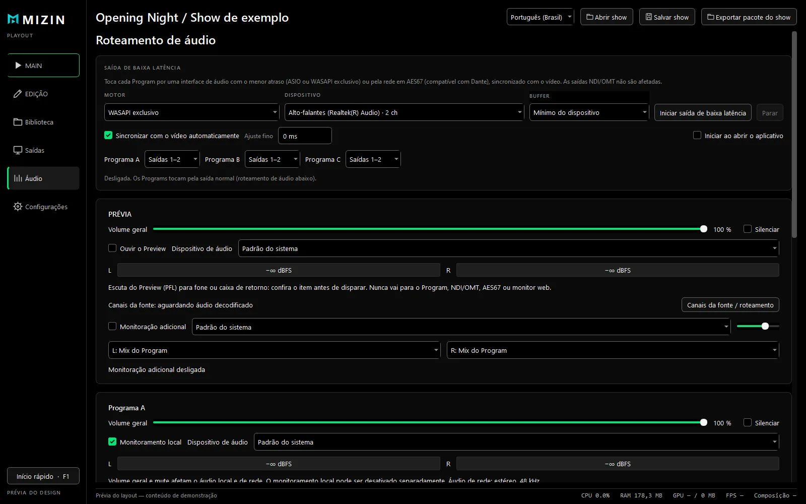
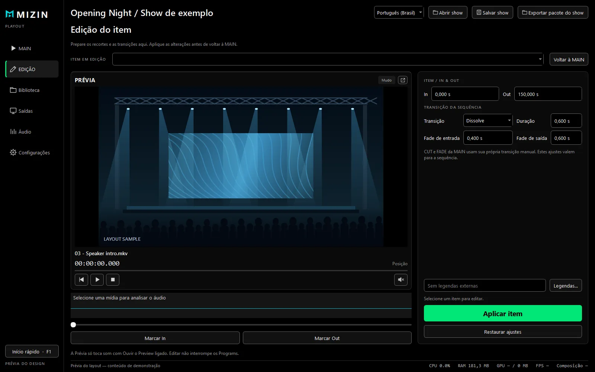
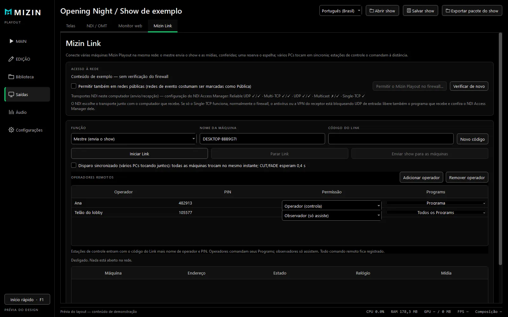

# Mizin Playout

Playout de vídeo ao vivo, feito para o show. Roda os vídeos do evento com **Programs independentes**,
CUT e FADE na hora, multiview, saídas para telas, **NDI** e **OMT**, monitor no navegador para toda a
equipe e áudio de baixa latência (WASAPI e **AES67**) — nativo no Windows, sem converter seus arquivos.

Site oficial, novidades, tutorial e verificação de versão: **https://playoutmizin.pages.dev**

> Este repositório guarda só os **downloads** (espelho do site), com o mesmo SHA-256 publicado no site.
> O código-fonte não é público. **[Baixar a versão mais recente →](https://github.com/samirbridi/mizin-playout/releases)**

## O que ele faz

- **Programs independentes.** Quantos o show precisar, cada um com abas de playlist, modo manual ou
  sequencial, loop, ponto de entrada, legendas (SRT, VTT, SubViewer e MicroDVD SUB) e waveform do áudio.
- **Disparos verificados.** A prévia confere o arquivo e o ponto de entrada antes do disparo. CUT e FADE
  (Ctrl+Enter / Ctrl+Espaço) nunca param os outros Programs.
- **Telas, espelhos e escala por GPU.** Cada Program vai para uma ou mais telas; espelhos compartilham
  quadros, sem decodificar de novo. Decks destacáveis com tally NO AR.
- **Vídeo pela rede.** NDI e Open Media Transport com áudio, na resolução e taxa de áudio do projeto
  (44,1, 48 ou 96 kHz). Painel de acesso à rede libera o app no Firewall do Windows com um clique.
- **Áudio de baixa latência.** WASAPI exclusivo a partir de 2 ms ou AES67 para sistemas Dante
  (até 64 canais, relógio PTP), sincronizado com o vídeo.
- **Monitor web** para diretores e equipe no celular, só visualização, protegido por código.
- **Várias máquinas, um show.** Mestre, reserva que assume se o principal cair e PCs sincronizados para
  telões de LED.
- **Salvamento automático, mídias religadas e pacotes** do show com todas as mídias.

## Telas

| | |
| :---: | :---: |
|  |  |
| **Saídas e rede:** Programs, telas, NDI/OMT e acesso à rede | **Áudio:** roteamento, monitoração e baixa latência |
|  |  |
| **Item:** ponto de entrada, legendas e waveform | **Mizin Link:** mestre, reserva e PCs sincronizados |

## Download

Em **[Releases](https://github.com/samirbridi/mizin-playout/releases)** cada versão traz:

- `MizinPlayout-…-setup.exe` — instalador para a sua conta de usuário (recomendado);
- `MizinPlayout-…-portable.zip` — portátil, roda até de um pendrive;
- a tabela de SHA-256, idêntica à do site. Para conferir no PowerShell: `Get-FileHash .\arquivo.exe`.

Windows 10 ou 11 (64 bits). Esta prévia ainda não tem assinatura digital: o SmartScreen pode mostrar
"O Windows protegeu o computador" — clique em **Mais informações → Executar assim mesmo**. O próprio app
avisa quando há versão nova e confere assinatura e hashes; nada é instalado durante o show.

---

## English

Live video playout built for the show: independent Programs, instant CUT and FADE, multiview, screen
outputs, NDI and OMT, a browser monitor for the whole crew and low-latency audio (WASAPI and AES67) —
native on Windows, no file conversion.

This repository only hosts the **downloads** (a mirror of the official site, same SHA-256). The source code
is not public. Get the latest version in **[Releases](https://github.com/samirbridi/mizin-playout/releases)**
or at **https://playoutmizin.pages.dev**.
